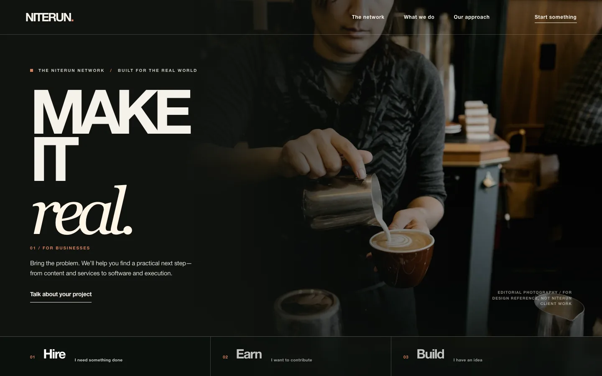

# NITERUN — Flagship Homepage V01

A **real, working, photography-first design study** of the NITERUN home page. This is *not* the production website at `niterun.com`, and no live lead, payment, or customer data is handled here.

**Preview (after GitHub Pages activates):** https://chaybuilds.github.io/niterun-flagship-preview/

## Design intent

- Real people and physical workplaces. No fabricated customers, reviews, revenue, holograms or AI-generated environments.
- One clear NITERUN identity that can extend to Academy, Services, and software products without repeating the same template.
- A functional *Hire / Earn / Build* hero: changing intent changes photography, copy and action.
- An adapted editorial accordion pattern initially researched on 21st.dev, and UX quality standards informed by the locally installed UI UX Pro Max skill.
- Every image is locally bundled. No externally hotlinked hero assets or required paid APIs.
- Intentional animation: progressive scroll reveals, tab image crossfades, subtly changing navigation treatment. All reduced when the device requests reduced motion.
- Plain HTML, CSS, JavaScript: no framework dependency, no runtime subscription, no analytics or cookie tracking.

## Run locally

Open `index.html` in your browser. No server or package installation required.

## Source / rights

See `THIRD_PARTY_NOTICES.md`. The photographs illustrate working environments; **none** represents verified NITERUN workers, clients, completed projects, or services. Confirm photo licensing and replace with original authorized NITERUN photography before production use.

## Release / acceptance gates

**Done in this prototype:** code syntax, desktop and mobile interaction checks, reduced-motion preference, local image delivery, 320px/390px responsive checks, no console JavaScript errors.

**Not done:** founder acceptance of visual direction, independent accessibility audit, production SEO, real buyer/payout reconciliation, and actual customer-service fulfillment or checkout testing. Public domain remains unchanged.

## References

- 21st Editorial service-list pattern, @ibrandify: https://21st.dev/@ibrandify/components/editorial-service-list
- 21st Editorial Hero 05 concept, @felipemenezes098: https://21st.dev/@felipemenezes098/components/hero-05
- UI UX Pro Max: https://github.com/nextlevelbuilder/ui-ux-pro-max-skill
- NITERUN approved/rejected design-feedback ledger: private `chaybuilds/niterun-design-brain`
